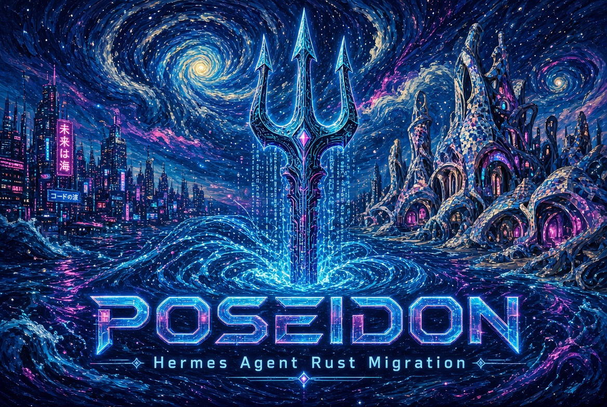
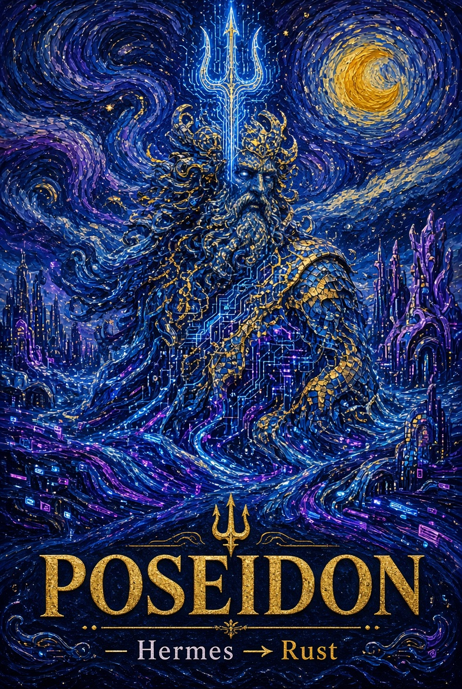

# Poseidon

**Hermes Agent → Rust / Tauri Migration**

> Turning the self-improving AI agent into a lean, native, high-performance system powered by Rust.





---

## What is this project?

**Poseidon** is the official workspace for the complete architectural migration and refactoring of [Hermes Agent](https://github.com/NousResearch/hermes-agent) (Nous Research) onto a modern **Rust + Tauri** foundation, inspired by the lightweight packaging philosophy of [Pake](https://github.com/tw93/Pake).

Hermes is currently a powerful multi-surface agent (CLI, TUI, Electron Desktop, messaging gateway with 25+ platforms, web dashboard, ACP). Its Desktop client is built on Electron, which brings significant size, memory, and startup costs.

Our mission:

- Replace the Electron shell with a **Tauri v2** native runtime (system WebView + Rust backend).
- Keep (and improve) the existing React UI.
- Preserve full compatibility with the Python agent core, gateway, skills, memory, and all existing surfaces.
- Dramatically reduce binary size (~5–15 MB vs 150–400+ MB), memory footprint, and cold-start time.
- Lay the groundwork for selective future Rust rewrites of performance-critical agent components.

**Poseidon** (the trident-wielding god of the sea) represents the power, depth, and control we are bringing to Hermes.

## Repository Structure

```
Poseidon/
├── README.md
├── docs/
│   ├── MANIFEST.md                 # 🔱 Библия проекта (Основной Закон)
│   ├── JOB_GROK.md                 # Должностная инструкция Grok
│   ├── JOB_KOLYAN.md               # Должностная инструкция Коляна
│   ├── DEVELOPMENT_JOURNAL.md      # Журнал разработки
│   ├── CORRESPONDENCE_JOURNAL.md   # Журнал переписки братьев
│   ├── ARCHITECTURE.md
│   ├── MIGRATION_PLAN.md
│   └── DECISIONS.md
├── assets/                         # Баннеры и визуал
└── ...
```

## Quick Links

- [Detailed Migration Plan](docs/MIGRATION_PLAN.md)
- Original Hermes: https://github.com/NousResearch/hermes-agent
- Pake (inspiration): https://github.com/tw93/Pake
- Official Hermes docs: https://hermes-agent.nousresearch.com

## Status

**Phase 0 – Foundation** (current)

- Repository bootstrapped
- Architecture analysis complete
- Migration plan published

Next: scaffold Tauri project + first working prototype packaging the Hermes Webapp / Desktop renderer.

## License

MIT (same spirit as Hermes). Code and documentation in this repository are under MIT unless otherwise noted.

---

*Built with the spirit of the deep sea — powerful, efficient, unstoppable.*
